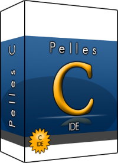

# wm_app_dev_lng_c__PellesC

<!--  -->

https://www.pellesc.se

Complete development kit for Desktop Windows.

https://forum.pellesc.de

* Home

https://github.com/wenuam/wm_app_dev_lng_c__PellesC

* Use

Shall be used from [wm_app]: see https://github.com/wenuam/wm_app/tree/main/dev/lng/c

[wm_app]: https://github.com/wenuam/wm_app

## Versions

List of currently available versions (as branches) :

| Version and date	|
| :---				|
| 14.50_260720		|
| 14.10_260424		|
| 14.00_260407		|
| 13.00_250521		|

The tag `latest` points to the most recent version.
